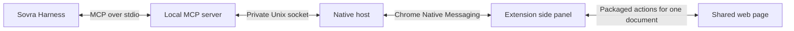

# Connecting Sovra Harness to a Chrome tab

Research and implementation decision, 21 November 2026.

A browser tab and a Sovra chat run in different processes. Sovra already discovers tools from a local program via the Model Context Protocol (MCP). Chrome already launches a local program for an extension via Native Messaging. This project joins those two connections and gives the user a Chrome side panel for sharing and reviewing actions. [Sovra connected services](https://github.com/Sovra-AI/SovraHarness/blob/48349e63f4ecfc96df61848bb9402feb35b01344/docs/connected-services.md) · [Chrome Native Messaging](https://developer.chrome.com/docs/extensions/develop/concepts/native-messaging)

## Where a Sovra integration belongs

Sovra's community plugin format packages skills and reference material. Its Connections screen is the existing path for executable tools. A user can paste an `mcpServers` object, inspect the executable and arguments, then choose **Run it**. Harness discovers the tool schemas and exposes enabled tools to chat. That lets a contributor develop this extension and try it with the desktop app from independent checkouts. [Plugin format](https://github.com/Sovra-AI/SovraHarness/blob/48349e63f4ecfc96df61848bb9402feb35b01344/docs/plugins.md) · [Program startup and tool discovery](https://github.com/Sovra-AI/SovraHarness/blob/48349e63f4ecfc96df61848bb9402feb35b01344/crates/sovra-runtime/src/mcp/programs.rs) · [Remote tools in the agent](https://github.com/Sovra-AI/SovraHarness/blob/48349e63f4ecfc96df61848bb9402feb35b01344/crates/sovra-adk/src/remote_tools.rs)

There are two distinct stdio protocols. The MCP client starts the server and exchanges newline-delimited JSON-RPC. Chrome starts the native host and exchanges JSON preceded by a 32-bit byte count in native byte order. Each process has a different parent and lifetime. The SDK owns MCP negotiation and tool schemas. A small host relays Chrome frames to the server through an owner-only socket directory. The server allows one browser peer and one outstanding action, correlates replies by ID, and clears requests when the connection closes. [MCP transports](https://modelcontextprotocol.io/specification/2025-11-25/basic/transports) · [MCP Python SDK](https://github.com/modelcontextprotocol/python-sdk) · [Native Messaging protocol](https://developer.chrome.com/docs/extensions/develop/concepts/native-messaging#native-messaging-host-protocol)

## Approaches considered

| Approach | What it buys | Consequence for Sovra |
| --- | --- | --- |
| Native Messaging | Chrome starts a host registered for a specific extension origin. Distribution includes an OS-specific registration step. [Native Messaging](https://developer.chrome.com/docs/extensions/develop/concepts/native-messaging) | Chosen. A normal browser profile works, and the bridge has no TCP listener. Linux and macOS can share the same Unix socket implementation. |
| Loopback WebSocket | An extension can connect to a desktop listener. Chrome 116+ can keep a worker alive when WebSocket traffic stays within its idle window. [Chrome WebSockets guide](https://developer.chrome.com/docs/extensions/how-to/web-platform/websockets) | Would also require discovery, peer authentication, origin checks and reconnect rules. An open socket alone would leave the worker lifetime uncertain. |
| Playwright MCP extension | An existing MCP implementation can connect to an existing Chrome or Edge browser. Its extension mode supports tab groups and a larger automation surface. [Microsoft Playwright MCP](https://github.com/microsoft/playwright-mcp#browser-extension) | A viable off-the-shelf option for general automation. Sovra's own extension can keep its tool contract small and present each proposed edit in its own UI. |
| Debugger API or remote debugging port | DevTools Protocol can instrument requests, inspect runtime state and send input. Chrome 136 changed how remote-debugging flags work with the default data directory. [Debugger API](https://developer.chrome.com/docs/extensions/reference/api/debugger) · [Chrome debugging-port changes](https://developer.chrome.com/blog/remote-debugging-port) | Adds capabilities beyond the four page tools. Programmatic DOM clicks have lower fidelity for sites requiring trusted input, but the starter can run with temporary page access. |
| Web-page messaging | An allowlisted web origin can send extension messages via the externally connectable interface. [Externally connectable](https://developer.chrome.com/docs/extensions/reference/manifest/externally-connectable) | Fits a web client. Sovra's desktop MCP client can reach the extension directly through the host. |

## How a user grants access

The toolbar action grants temporary host access to the active tab. Chrome may keep that grant across same-origin navigation. This implementation separately captures the top document's ID and original URL. Every subsequent page operation checks that binding. A new document requires a new share, even at the same origin. Side-panel code owns the native port, while the worker only opens the panel. A worker restart has no saved grant to reconstruct. [Chrome activeTab](https://developer.chrome.com/docs/extensions/develop/concepts/activeTab) · [Scripting targets and document IDs](https://developer.chrome.com/docs/extensions/reference/api/scripting#type-InjectionTarget) · [Side panels](https://developer.chrome.com/docs/extensions/reference/api/sidePanel) · [Worker lifecycle](https://developer.chrome.com/docs/extensions/develop/concepts/service-workers/lifecycle)

Chrome isolates the extension's JavaScript state from page scripts. Both still see the same DOM, so the page can replace an element, change a link or attach arbitrary event handlers. The snapshot returns temporary references to live elements. To accept a click or fill, the panel shows the current control label and destination or proposed text. The extension rechecks the same element, visibility, label, control type and link destination when the user approves. Labels and page text remain untrusted. Approval of a button permits the site's handler to run, including any form submission it performs. [Content-script execution worlds](https://developer.chrome.com/docs/extensions/develop/concepts/content-scripts#work_in_isolated_worlds) · [MCP tool interactions](https://modelcontextprotocol.io/specification/2025-11-25/server/tools)

Scrolling and reading return immediately. A review expires after 45 seconds. The bridge allows 55 seconds for a response, inside Harness's two-minute local program call deadline. On loss of contact, the caller can take a fresh snapshot before trying another change. A navigation can end sharing immediately after an accepted click, before its success message reaches Sovra. [Harness program transport](https://github.com/Sovra-AI/SovraHarness/blob/48349e63f4ecfc96df61848bb9402feb35b01344/crates/sovra-runtime/src/mcp/programs.rs)

## Installation, trust and distribution

Chrome requires an exact extension origin in the native manifest. The checked-in public key gives unpacked builds a stable development ID on different machines. The installer writes a per-user manifest and a launcher with absolute paths. The OS account, Chrome profile, installed extension, checkout and approved MCP executable belong to the trust boundary. A process with the user's own OS privileges can access the local socket. Windows distribution would need a suitable executable, native-host registration in the registry and an IPC transport with a per-user access control list. [Native host locations and allowed origins](https://developer.chrome.com/docs/extensions/develop/concepts/native-messaging#native-messaging-host-location) · [Stable extension IDs](https://developer.chrome.com/docs/extensions/reference/manifest/key)

The repository distributes an unpacked developer build. A Chrome Web Store release would require a package, its assigned extension ID and matching native allowlist, permission justifications, a privacy disclosure and a separately installable companion. Chrome's MV3 policy requires the operating logic to be reviewable in the submitted package. Each bridge command selects a packaged function. The limited-use policy constrains browsing data to the disclosed user-facing purpose. A configured remote model may receive the selected page's tool result through Harness. [Manifest V3 policies](https://developer.chrome.com/docs/webstore/program-policies/mv3-requirements) · [Limited Use](https://developer.chrome.com/docs/webstore/program-policies/limited-use) · [User-data disclosures](https://developer.chrome.com/docs/webstore/program-policies/user-data-faq)

## Verification and next engineering decisions

The Linux browser test uses a disposable Chrome for Testing profile, a fixture page, the real extension action, the real native host manifest and an MCP client. It checks resulting DOM state after accepting or declining an action, including a link whose destination changes during review. Chrome's debugging interface is used by the test driver only. [Extension end-to-end testing](https://developer.chrome.com/docs/extensions/how-to/test/end-to-end-testing) · [Playwright extension testing](https://playwright.dev/docs/chrome-extensions)

A separate Linux integration run used the Sovra runtime's connection importer, MCP program runner and tool-result events with the same browser fixture. The installer output led to discovery of all four tools. The run observed the approved text in the field, the approved button's DOM effect, a declined click, a changed link rejected during review, and disconnects after navigation, switching tabs and closing the panel. This exercised the Harness runtime below the chat UI.

The next coverage decisions are native Windows packaging, macOS browser validation and support for additional page controls. Cross-frame interaction would need an explicit frame and origin model. Moving to trusted input events would change the permission model and merits a separate review. [Chrome scripting API](https://developer.chrome.com/docs/extensions/reference/api/scripting) · [Chrome debugger API](https://developer.chrome.com/docs/extensions/reference/api/debugger)
